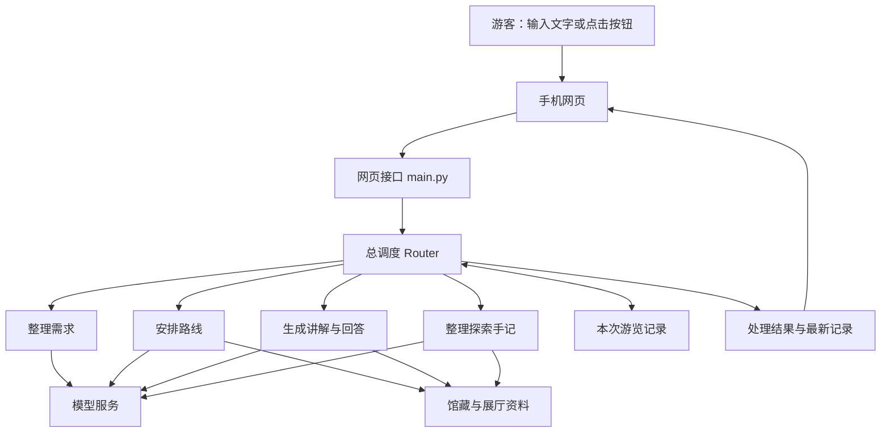

# 博物馆导览 Agent：架构、工作流程与开发进度

更新日期：2026-10-20。

本文依据《需求文档.txt》《开发交接.md》、当前代码和本次实际验证整理。旧文档中与当前代码不一致的描述，以本文注明的现状为准。

## 1. 这个 Agent 做什么

游客说出兴趣和可用时间，系统安排路线；到达展品后再生成讲解。途中可以追问、跳过展品或改变需求，系统保留已有记录，只重排待看部分。结束后，系统把本次讲解和问答整理成《探索手记》。

整个过程可以概括为：**了解需求 → 安排路线 → 逐件讲解 → 随时调整 → 整理手记**。

## 2. 整体架构

| 部分 | 负责什么 | 主要文件 |
| --- | --- | --- |
| 手机网页 | 收集需求，显示路线、讲解、问答和手记 | `index.html`、`style.css`、`app.js` |
| 网页接口 | 接收页面请求，交给总调度，把结果返回页面 | `main.py` |
| 总调度 | 决定先做什么、后做什么，管理时间、位置和播放进度 | `router.py` |
| 游览记录 | 保存本次游客信息、已参观列表、待看列表和讲解问答 | `session_state.py` |
| 整理需求 | 从文字中提取需求、问题和结束意图 | `operators.py`、`input_interpreter_prompt.py` |
| 安排路线 | 整理兴趣，给展品打分，再根据位置和时间安排顺序 | `interest_prompts.py`、`route_*.py` |
| 生成讲解 | 读取资料、选择内容、写讲解、检查后保存 | `guide_*.py` |
| 整理手记 | 读取本次讲解问答，写成手记并检查 | `summary_*.py` |
| 模型服务 | 读取模型配置，发送请求，检查返回内容 | `model_api.py`、`model_services.py`、`llm_config.json` |
| 馆藏资料 | 提供展品说明、标签、位置、通路、来源和展品之间的关系 | `data/` 及后续资料读取代码 |

### 页面怎样调用后台

| 接口 | 用途 |
| --- | --- |
| `POST /api/session` | 新建一次游览 |
| `POST /api/event` | 处理按钮操作，如开始讲解、跳过、重排和结束 |
| `POST /api/chat` | 处理游客输入的文字 |
| `GET /api/state` | 读取本次游览的最新记录 |
| `GET /health` | 检查服务是否能响应 |

游览请求处理后，后台返回“本次结果”和“最新游览记录”，页面据此更新。页面不能直接覆盖后台的游览记录。

## 3. 一次游览怎样运行

### 第一步：创建游览，整理需求

页面先创建游览编号，区分不同游客的记录。游客填写可用时间，再输入想法或选择页面推荐主题。

系统把需求整理成五类：

| 游客信息 | 例子 |
| --- | --- |
| 内容兴趣 | 想了解青铜器、古人的生活 |
| 讲解风格 | 生动、通俗、简洁 |
| 讲解角度 | 制作工艺、历史背景 |
| 剩余时间 | 45 分钟 |
| 其他需求 | 带孩子、需要休息、无障碍需求 |

文字交给模型理解；按钮名称和已填好的字段由程序直接处理。一次输入可以同时包含需求调整和当前展品的问题。

### 第二步：安排路线

规划前需要有内容兴趣、剩余时间、当前位置和出口位置。还需要真实的展品与展厅资料。

程序按以下顺序工作：

1. 把游客兴趣整理成可匹配的标签，例如时代、品类、工艺、题材。
2. 把当前内容兴趣转换成一串数字，即“兴趣向量”。
3. 排除已参观和未开放的展品，为其余展品打分。
4. 每个展厅先选出适合的展品，再计算走路、穿厅、停留和跨楼层的时间。
5. 在时间允许的范围内安排展厅和展品顺序，写入待看列表。

每件展品的分数由三部分组成：

| 分数 | 判断什么 | 最高分 |
| --- | --- | --- |
| 标签分 | 游客要求与展品标签是否匹配 | 50 |
| 文字含义分 | 游客兴趣与展品介绍的意思有多接近 | 30 |
| 重要度分 | 展品本身的重要程度 | 20 |

文字含义比较的双方是：**游客兴趣向量 ↔ 每件展品提前保存的向量**。后台计算两个向量的接近程度，再换算成分数；当前接近程度不高于 0.5 时，这部分得 0 分。

每件展品的向量，需要先把名称、年代、类别、主题和权威介绍等文字交给向量模型生成并保存。游客兴趣和展品资料必须使用同一个模型、相同版本和相同向量长度。目前已验证 `GLM-Embedding-3` 返回 2048 个数字。

展品数量由时间和筛选结果决定，已经取消“全程固定 5–8 件”的早期设定。路线主要给分数高的展品安排停留，也可以在顺路时补入重要展品。

### 第三步：到展品前，再生成讲解

游客点击“开始讲解”后，系统只为待看列表中的第一件展品生成内容：

1. 按展品编号读取可信资料原文和来源。
2. 模型从资料中挑选适合游客兴趣、风格和讲解角度的内容。
3. 模型根据选中的内容写出讲解，分成可播放的句子或段落。
4. 另发一次模型请求，检查讲解是否忠于资料。
5. 检查通过后保存讲稿，把该展品移入已参观列表。

“可信资料”至少包含资料编号、原文和来源。当前需要补上的资料读取功能，就是“按展品编号找到这些内容，再交给讲解流程”。

**当前代码把主讲生成成功记为已参观，不表示游客已经听完。** 实际播放进度另外保存。当前也要等整篇讲解写完并检查通过，才返回页面。

### 第四步：追问、跳过和调整路线

| 游客操作 | 系统怎么处理 |
| --- | --- |
| 追问当前展品 | 根据当前展品、问题和播放进度生成独立回答，保存原问题与回答 |
| 回答后继续讲解 | 后台保留原稿和中断位置，支持请求恢复；真实音频播放仍待接入 |
| 改兴趣、时间或其他需求 | 更新游客信息，从当前位置重新安排待看部分 |
| 只改讲解风格或角度 | 留给后续讲解使用，通常不重排路线 |
| 跳过展品 | 移出待看列表，记为跳过，不计入已参观 |
| 更新位置 | 保存真实当前位置，供之后规划使用 |

重排不会删除已参观记录、原讲稿或问答。当前跳过的展品可能在之后重排时再次被推荐。

后台按实际经过的时间扣减余额；预计路线用时只是规划参考。时间用完会清空待看列表，但不会自动结束游览。新路线生成失败时保留旧列表，并提示路线需要更新。

### 第五步：结束游览，整理手记

游客可以填写最有印象的展品和感想，两项都能跳过。

系统结束游览，读取本次成功生成的全部主讲和问答，并查询相关展品的名称、年代和展厅。模型据此整理手记，再由另一次模型请求检查。

手记包括参观足迹、沿途发现、有依据的展品联系、精选问答和后续探索方向。个人感想按游客原意保留。

手记按已生成内容取材，不按是否听完筛选。结束后停止修改游览记录；手记失败时可以重新请求生成。

## 4. 模型具体做哪七件事

七项工作可以使用同一个 `GLM-5.3`，每项使用不同的要求和输入。它们不代表七个不同的模型。

| 模型工作 | 输入 | 输出 |
| --- | --- | --- |
| 理解输入 `interpreter` | 游客文字、当前游客信息和讲解情况 | 需求变化、当前问题、重排或结束意图 |
| 整理兴趣 `interest_parser` | 当前游客信息 | 路线打分所需的兴趣标签 |
| 选择资料 `selector` | 当前展品、游客需求、候选资料 | 本次讲解要用的材料 |
| 写讲解 `composer` | 选好的材料、游客需求和问题 | 主讲稿或追问回答 |
| 检查讲解 `reviewer` | 请求、材料和讲稿 | 是否通过，以及具体问题 |
| 写手记 `summary_composer` | 参观记录、全部讲解问答、展品资料和反馈 | 探索手记草稿 |
| 检查手记 `summary_reviewer` | 本次记录和手记草稿 | 是否通过，以及具体问题 |

向量服务单独使用 `GLM-Embedding-3`，负责把文字变成数字，不属于上述七项工作。

模型负责理解和写作；程序负责打分、算路、计时、检查格式和保存记录。讲解和手记的模型检查还需要用真实资料验证效果。

## 5. 现在已经完成什么

| 项目 | 当前进度 |
| --- | --- |
| 游览记录 | 已能保存五类游客信息、已参观、待看、跳过、主讲和问答；不同游览分开管理 |
| 总调度 | 已能处理按钮、文字、位置、时间、重排、播放进度和结束请求 |
| 四个主要步骤 | 整理需求、安排路线、生成讲解、整理手记的代码流程均已实现 |
| 路线计算 | 已实现标签与向量评分、展厅选择、通路计算、时间控制和待看列表更新 |
| 讲解与手记检查 | 已有模型写作、单独检查、格式检查和保存流程 |
| 七项模型服务 | 已统一装配；当前 `main.py` 启动时会接入，资料仍需另外提供 |
| 网页接口与页面 | 已有创建游览、事件、文字和查询接口；已有需求、路线、讲解、追问、重排、结束和手记页面 |
| 播放进度 | 后台已有进度校验与原稿恢复支持；页面已有按时间模拟的播放与进度上报 |
| API 密钥 | 用户已填入；本文不记录密钥内容 |
| 向量接口实测 | 本次已成功调用 `https://llmapi.paratera.com/embeddings`；使用 `GLM-Embedding-3`，从 `data[0].embedding` 读取到 2048 维向量 |
| 本地测试 | 2026-10-20 重新运行，199 项通过；主要验证程序流程和数据检查，使用模拟模型服务 |

页面和主要代码已经具备基础，但还不能完成一次使用真实馆藏的完整导览。

## 6. 现在还要做什么

### 先补齐完整演示需要的内容

| 顺序 | 待完成任务 | 完成后能做什么 |
| --- | --- | --- |
| 1 | 准备真实展品资料、标签、重要度和权威来源 | 让推荐和讲解有真实内容可用 |
| 2 | 准备展厅、楼层、入口、出口、通路和步行时间，并接入路线读取功能 | 让系统按真实场馆安排路线 |
| 3 | 按统一文字格式为每件展品生成 2048 维向量，并保存模型信息 | 让游客兴趣与真实展品进行含义比较 |
| 4 | 实现按展品编号读取候选资料，并接到讲解流程 | 让选材、写讲解和检查真正运行 |
| 5 | 接入手记所需的展品名称、年代和展厅资料 | 让真实游览记录能生成完整手记 |
| 6 | 用真实密钥和资料验证七项模型工作 | 确认理解、写作、检查、返回格式和用时符合要求 |
| 7 | 把讲解文字变成声音，接入真实音频播放、暂停、追问和恢复 | 让播放进度代表实际听到的位置 |
| 8 | 从手机页面完整走一遍需求、路线、讲解、调整和手记 | 找出页面与后台配合的问题，校准路线时间和讲解效果 |

`data/relics.json` 和 `data/edges.json` 当前仍为空。前者计划存放展品资料，后者计划存放查证后的展品关系；展厅通路是另一类数据，不能用展品知识关系代替。

### 正式使用前需要补齐

| 待完成任务 | 目的 |
| --- | --- |
| 自动保存游览记录、路线、播放位置和手记 | 服务重启后仍能继续游览 |
| 用户身份和访问限制 | 让游客只能访问自己的记录 |
| 多个服务进程之间的协调，以及正式运行配置 | 支持多人使用，避免重复处理和记录冲突 |

### 后续按需要增加

边生成边播放、自动修改未播内容、重复讲解检测、手记图片或 PDF 导出，目前都未实现。它们可以在基础演示跑通、实际试用后再决定是否加入。
